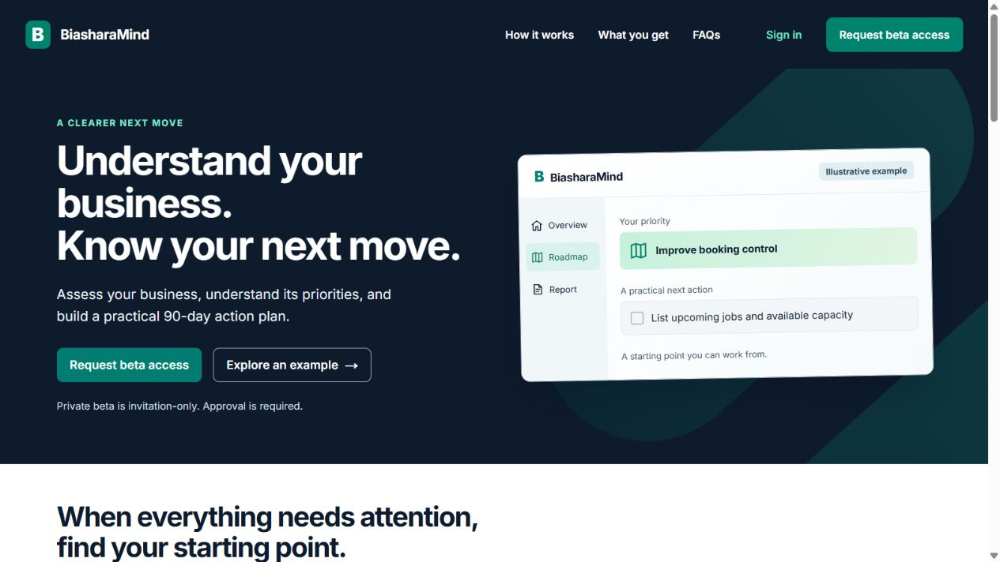

# Hi, I’m Mark Jacob Nyumba

**Data Scientist & AI Engineer · Founder / builder of BiasharaMind · Nairobi, Kenya**

I build data pipelines, machine-learning models and AI applications that turn complex information into practical decision support. My background in geospatial engineering connects spatial analysis with data science, software development and digital transformation.

[LinkedIn](https://www.linkedin.com/in/mark-nyumba-953099214) · [GitHub](https://github.com/BEMOREMJ)

---

## Featured project · BiasharaMind

**Founder and builder · Deployed product in private beta**

An SME decision-support platform that turns structured business assessments into diagnoses, priorities and practical 90-day roadmaps.

[Visit BiasharaMind →](https://biasharamind.netlify.app/)

I designed and built the product workflow, data models, application and evaluation controls. Deterministic logic governs scoring and prioritization; AI supports bounded interpretation and writing through structured outputs.

**Built with:** Next.js · TypeScript · FastAPI · Python · PostgreSQL · Supabase · OpenAI · Opik

**Engineering focus:** data modelling, LLM evaluation, controlled generation, automated backend testing, observability, retries and recovery.

BiasharaMind remains in controlled beta, with usefulness, repeat use and business outcomes still being evaluated.

### BiasharaMind fine-tuning · Qwen2.5-7B

**Solo experimental case study · Completed experiment**

Explored adapting Qwen2.5-7B for bounded SME-advisory explanation and writing tasks in the BiasharaMind context.

- Prepared instruction-style training examples with attention to consistency and leakage.
- Applied LoRA adaptation to limit trainable parameters on constrained compute.
- Compared adapted outputs with the base model using repeatable prompts and review criteria, while keeping deterministic controls authoritative.

`Python` `PyTorch` `Qwen2.5-7B` `LoRA` `LLM evaluation`

This research experiment is separate from the deployed BiasharaMind application. Formal benchmarking, safety assessment and cost analysis remain to be documented.

## More selected work

### Kenya Economic Data Platform

**Solo project · Data engineering**

A historical data platform with reproducible ingestion, BigQuery and dbt models, quality checks, backfills and recovery controls. Its deployed Plotly dashboard presents historical weather data.

`Python` `SQL` `BigQuery Sandbox` `dbt Core` `SQLite` `Plotly` `GitHub Actions`

[Explore the repository →](https://github.com/BEMOREMJ/kenya-economic-data-platform)

### Global Water Storage Forecasting

**Solo project · Geospatial machine learning**

A leakage-safe forecasting case study using rolling-origin validation, multi-horizon diagnostics and evidence-based model selection. The repository preserves reproducible experiments and rejected alternatives alongside the selected model.

`Python` `LightGBM` `CatBoost` `Polars` `DuckDB` `scikit-learn`

[Explore the repository →](https://github.com/BEMOREMJ/forecasting-global-water-storage)

### MajiWatch

**Solo project · Geospatial application**

A deployed V1 proof of concept connecting water-related observations with map context and a verifiable application workflow.

`Next.js` `Geospatial web application` `Base Sepolia` `Smart contracts`

[Explore the repository →](https://github.com/BEMOREMJ/majiwatch)

<strong>More projects and collaborative contributions</strong>

- **Pneumonia Detection** — Solo academic / portfolio study of chest X-ray image classification using TensorFlow, Keras, NumPy and pandas. Educational prototype.
- **Raimon Agent Workflow** — Collaborative contributor to agent workflow engineering using Python, LangGraph, CrewAI and Git, with explicit state transitions and review points.
- **FormFit Browser Pose Tracking** — Collaborative feature contribution using TypeScript, MediaPipe and Browser APIs for deterministic squat analysis and immediate movement feedback. Browser pose-tracking prototype.

## Skills & tools

| Area | Tools and capabilities |
| --- | --- |
| **Languages** | Python · SQL · TypeScript |
| **Data science & analytics** | NumPy · pandas · Polars · Statistical analysis · Data visualization · Power BI · Plotly · Decision support |
| **Machine learning & computer vision** | scikit-learn · TensorFlow / Keras · PyTorch · LightGBM · CatBoost · Forecasting · Time-series forecasting · Geospatial ML · Computer vision · MediaPipe · Reproducible ML |
| **Generative AI & agents** | OpenAI · Qwen2.5-7B · LoRA · LLM evaluation · Structured outputs · LangGraph · CrewAI · Opik · Bounded generation · Agent orchestration |
| **Data engineering & databases** | Data modelling · ETL workflows · Data validation · PostgreSQL · Supabase · BigQuery Sandbox · dbt Core · DuckDB · SQLite · Quality checks · Backfills · Recovery controls |
| **Backend & web applications** | FastAPI · APIs · Next.js · Browser APIs · Geospatial web application · Deterministic analysis · HTML · CSS |
| **Geospatial systems** | ArcGIS Pro · Google Earth Engine · Geospatial analysis · Spatial data science |
| **Digital transformation & delivery** | Enterprise architecture · BPMN · Ardoq · Camunda · Process improvement · Requirements gathering · Product ownership · Stakeholder coordination |
| **Development & publishing** | Git · GitHub Actions · GitHub Pages · Node.js · pnpm · Automated testing · Static site export |
| **Blockchain prototyping** | Base Sepolia · Smart contracts |

## Background

- **BSc Geospatial Engineering** — University of Nairobi · Upper Second-Class Honours
- **Data Science** — Moringa School

<strong>Certifications & further learning</strong>

- Oracle Cloud Infrastructure 2025 Certified Data Science Professional
- Oracle Cloud Infrastructure 2025 Certified AI Foundations Associate
- Oracle Cloud Infrastructure Generative AI Professional
- Spatial Data Science: The New Frontier in Analytics — Esri
- CrewAI: Building Multi-Agent Systems
- Building Agentic Systems with LangGraph

---

**Let’s connect:** [LinkedIn](https://www.linkedin.com/in/mark-nyumba-953099214)
